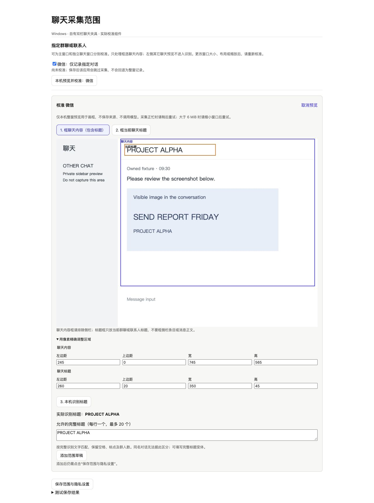

# 聊天事项与个人工作中心

在浏览器侧栏点击“打开工作中心”，使用今日、待办、对话、资料和活动记录。项目、历史、知识、会议、技能、MCP 和 Agent 执行记录继续使用已有入口；个人待办与 Agent 的执行任务板分别保存。

## 记录聊天与整理事项

活动记录默认关闭。先选择要记录的应用，再核对范围并开启记录。只记录指定应用当前前台窗口的可见内容，不会打开或切换聊天、滚动、读取聊天数据库或发送消息。微信、钉钉等未显示消息不在覆盖范围内。后台返回平台能力与原因，无法验证身份、焦点、锁屏状态或窗口被遮挡时跳过，不抢焦点或回退为全屏。

| 平台 | 自动采集与本地 OCR | 系统要求与边界 |
| --- | --- | --- |
| macOS | 指定前台应用窗口，Vision OCR | 屏幕录制及辅助功能授权；安全输入/敏感应用跳过 |
| Windows | 指定前台窗口，被动截图与本机 OCR | 普通交互桌面、可验证的进程/窗口身份及权限、已安装的 OCR 语言；密码焦点或状态不明跳过；不恢复最小化窗口 |
| Linux X11 | 指定前台窗口，Tesseract OCR | 明确的本机 Unix DISPLAY / X11 会话（不支持 SSH 转发）、XRes 实际进程身份、XScreenSaver 和可核实的桌面锁屏服务；缺失或未知时拒绝 |
| Linux Wayland / 无桌面 / 会话不明 | 主动导入 PNG → 所选识别模式 → 核对整理 | 不声称支持后台应用轮询；不会利用 XWayland 把不明窗口当成前台应用 |

Windows/Linux 的应用选择保存实际进程映像路径的身份摘要，不以可伪造的窗口标题或应用自报 PID 授权。升级或路径变化后可能需要重新选择应用。macOS 旧 bundle ID 配置保留。

Linux 使用系统 Python3、libX11、libXss、libXRes、gdbus、Tesseract；通知还需 libnotify 及桌面通知服务。例如 Debian/Ubuntu 可由用户执行 `sudo apt install python3 libx11-6 libxss1 libxres1 libglib2.0-bin tesseract-ocr tesseract-ocr-chi-sim libnotify-bin`。兼容的 GNOME/Freedesktop/Xfce/MATE/Cinnamon 锁屏服务须正在用户桌面总线上运行；仅有 XScreenSaver 的 bare window manager 不足以证明合成器锁屏状态，未知时使用主动导入。后台不会自动安装包或启动锁屏服务。

本地 OCR 可选简体中文、繁体中文或英语。Windows 需在系统语言设置安装对应 OCR 组件；Linux 的语言包分别为 `chi_sim+eng`、`chi_tra+eng`、`eng`，缺少时明确报错。英语不冒称已支持中文。

## Windows：稳定选择运行进程

Windows 列表按同一交互会话中的进程身份枚举，包含后台、最小化和隐藏的程序。可搜索微信/WeChat、企业微信/WeCom、钉钉/DingTalk、飞书/Feishu/Lark、QQ、进程名称或身份摘要。窗口状态只用于说明，不代表当前焦点、权限、遮挡或对话范围已允许采集。

刷新、搜索和翻页保留已选应用；已选但本次未发现的应用仍可取消。超过 4096 项或枚举失败时明确提示，保留已有列表，不用不完整结果冒称成功。

最短检查间隔可设为 **3 秒**。上一轮截图、OCR 或模型识别未完成时等待，不并发、不积压补发；处理较慢时实际间隔会增加。默认值与已有用户设置不会因升级自动改变。

## Windows：只记录某个群聊或联系人

为所选应用勾选“仅记录指定对话”。采用本机可见标题核对与区域裁剪，主窗口、独立聊天窗口均可分别校准；不读取聊天数据库或内部会话接口。

1. 点击“本机预览并校准”，在 5 秒内手动切到目标聊天窗口。预览只在本机处理，不保存来源、不调用模型；正忙时稍后重试，超过 6 MiB 时先缩小窗口。
2. 框选聊天内容，包含顶部当前聊天标题并排除侧栏其它聊天；再在内容框内单独框选标题。可展开像素输入，用键盘精确调整。
3. 点击“本机识别标题”，核对 OCR 实际文字；填写允许的完整标题，每行一个，最多 20 个。保留空格、标点及群人数，不做子串或模糊匹配。
4. 添加范围草稿，再“保存范围与隐私设置”。画框、添加草稿本身不保存；保存范围后仍需单独开启采集。

每次在同一冻结截图上核对标题，匹配后只保存和处理聊天内容裁剪图，侧栏其它聊天不进入 OCR、视觉模型或本机 Qwen3-VL。标题不符、读不到、未校准或布局尺寸变化时跳过并说明原因，不回退整窗记录。

同一应用最多保存 8 种窗口布局；主窗和独立窗分别校准，同布局重设会明确替换。窗口尺寸、布局、缩放或 OCR 语言变化后请重新核对。相同可见标题的对话无法据此区分，不声称取得内部唯一会话 ID。五款软件的具体版本与权限组合未逐一现场认证；通用 Windows 原生夹具验证的是被动截图、标题识别和裁剪调用链。

来源更新不会清空设置草稿。保存前读取最新配置；真正的配置/图片目标变化或读写间并发修改仍会拒绝保存并保留草稿，不自动重试。

## 主动导入

三端均可主动选择非空且不超过 **6 MiB** 的 PNG；主动导入不会启用后台采集，也不套用自动窗口的对话范围规则。导入来源标为“用户导入截图（应用未核实）”，导入时间不是原消息时间；原应用、群、提出人和时间须人工核对。系统无法对主动提供的图片应用前台应用排除规则。

在活动记录设置中选择识别方式：

- **本地 OCR**：在本机识别文字，不自动调用模型。可手动整理，或单独授权将 OCR 文本、窗口标题及必要时间上下文交给模型抽取；这条请求不发送原始截图。
- **复用图像识别配置**：使用视觉设置中的模型与鉴权，支持 OpenAI 兼容与 Anthropic Messages。
- **单独配置图像模型**：为聊天截图指定独立协议、端点、模型与 Key，可与普通聊天和辅助视觉分开。
- **本机 Qwen3-VL**：直接使用实验功能的本地模型；先完成安装与预检。推理只读取本地模型文件，失败时不会回退云端。模型安装和首次下载说明见 [Qwen3-VL 指南](qwen-vl-experimental-layer.md)。

后三种图片模式须核对显示的实际处理目标，勾选图片处理授权并保存。导入截图后会直接生成待确认候选，自动采集也按所选模式处理。远端视觉模式会将截图发送到所选端点；更换处理目标后须重新核对授权。截图保存在本机不代表模型处理也在本机。

未识别出文字或只得到空白时，不会仅因文本相同而丢弃不同截图；相同图像仍会去重。非空识别文本完全相同时，保留现有文本去重规则。导入来源的截止时间不按导入日期自动推算，须用户确认填写。

抽取结果先进入候选区。核对提出人、群或对话、引用、负责人、截止、提醒和反馈去向后确认。来源中没有识别到的字段显示未知；截图和 OCR 可能有遗漏，需要人工核对。视觉模式也可读取聊天内可见图片中的清晰文字；缩略图读不清时可主动导入清晰截图，不会自动打开原图或滚动历史。重复确认保留同一个事项身份，较旧的编辑拒绝覆盖更新内容。

处理完成和反馈完成分别记录。勾选“已向来源反馈”只是保存用户确认，不会向聊天软件发送消息。原始来源可独立清理；已确认事项保留，但引用原文随来源一并移除。

来源信息、OCR 文本和事项共享独立的 **16 MiB 元数据预算**，可能先于截图容量上限达到预算。超额写入会明确返回 `QUOTA_EXCEEDED`，保留原有内容；事项编辑或提醒状态写入也可能因此受阻。先清理来源可恢复写入；已确认事项保留，但来源引用会清除。截图存储上限单独计算，手动导入上限为 6 MiB，本地 PNG 解码上限为 8 MiB。

## 批量整理

完整工作中心的“待办”页可显式勾选多个事项，核对所选清单后分别记录“已处理”或“已反馈”；处理完成不会自动清掉待反馈状态。筛选与搜索外的选择也会列入核对清单，可用“清除选择”重新选择。“待整理”中的候选可批量忽略，但建立正式待办仍须逐条核对来源、责任人和时间。

每项依次等待后台保存确认，首项未确认即停止后续提交。结果分别显示后台确认、未确认与未发送；已发送后断线或离开页面不代表后台回滚，请先刷新核实，不会自动重试。事项版本或连接变化后，保留原选择并要求重新核对。批量操作不创建提醒、不改来源内容，也不向聊天软件发送反馈。

## 提醒

用户确认的提醒时间保存在本机，由运行中的 Companion 后台检查，不依赖浏览器侧栏持续打开。重启或设备休眠后会补查已经到时的排程。Companion 停止、设备关机或系统免打扰时不能保证按时展示。Linux 无图形通知服务或未安装 libnotify 会明确失败；Windows 使用安装包附带的 SnoreToast，以真实退出状态判定提交，缺少程序不记成功。状态区分已排程、正在提交、已提交系统通知、失败和未知；提交成功不证明用户已看到。崩溃后的不确定通知不会盲目重发，用户可以重新安排提醒。

## 用一句话调整设置

在设置中描述目标或症状，点击“生成候选”。模型只能从允许的设置目录提出方案；界面显示当前值、建议值、理由、影响与前置条件。选择方案和项目后显式提交，保存结果读取核对；配置已变化或候选过期时需要重新生成。语音输入结束只填写描述。

语音引擎、记录隐私、待办提醒与危险权限等需要在对应入口单独操作的项目，会明确标记并提供导航。它们不会通过模型候选静默启用、授权、下载或发送消息。模型不可用时保留输入及普通设置入口，不用固定规则伪装为语义理解。

工作中心的站点设置需要具体网页上下文。完整工作页本身不是被统计网页；需要刷新或重置某个站点时，请在该网页打开侧栏后操作。

安全确认或计算机任务阻止离开当前页面时，设置保持打开并提示受阻。会议、场景等入口等待当前线程的面板实际接受后再报告成功；切换线程会取消旧导航结果。

### 离线查找语音设置（#754）

在「用一句话调整设置」输入连续听写、热键、识别引擎、纠错或实时出字指令，可点击「规则导航：打开语音设置」。此入口无需模型，只打开对应设置页；不会按指令自动切换开关或保存配置。请在语音设置核对并手动更改。AI 生成候选和确认提交的流程保持独立。
