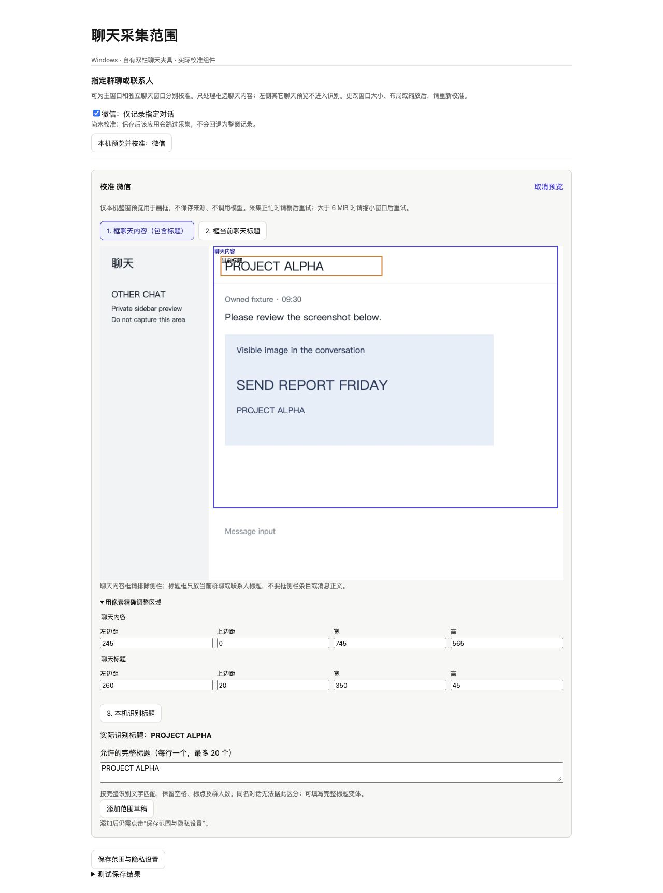

# 聊天事项与个人工作中心

在浏览器侧栏点击“打开工作中心”，使用今日、待办、对话、资料和活动记录。项目、历史、知识、会议、技能、MCP 和 Agent 执行记录继续使用已有入口；个人待办与 Agent 的执行任务板分别保存。

## Mini 桌面小球

启动 CMspark 托盘后，桌面会出现 Mini。点托盘菜单「显示 Mini 桌面小球」可以隐藏或重新显示，下次启动会沿用选择。macOS 的托盘在屏幕顶部菜单栏。

单击 Mini 小球会展开操作菜单。长按约半秒直接进入快速对话，拖动小球可以移动位置。右键也能打开菜单。

在「截图」里点「抽取待办」「询问图片」「OCR 识别」或「仅截图」，默认立即框选。要截取下拉菜单或悬浮提示，选「截图 → 延时截图」，选择 3、5 或 10 秒，再选择截图用途。macOS、Windows 和 Linux X11 在框选结束后开始计时。松手后可以去展开目标界面，时间到时读取选区。延时只对本次截图生效。

- macOS 支持单击扇形菜单中的操作，按 Esc 可取消菜单或选区。首次截图时按系统提示授予屏幕录制权限。
- Linux 使用 GTK 3。Wayland 由系统截屏门户提供画面，选择延时后先展开目标界面，倒计时结束后在门户中选取画面，再在预览中框选。只有选区会交给后续操作。
- 快聊窗口里的「更多 → 置顶显示」可在支持该功能的浏览器上把聊天固定在其他应用上方。

### Windows 的快聊、扇形菜单和快捷键

启动 Windows 版 CMspark 托盘后，小球会出现在桌面上。长按小球可在球旁展开快聊，使用设置中的主模型继续对话。收起再展开可以继续这段快聊。对话保存在内存中，退出托盘或从托盘隐藏小球会结束会话。直接拖动可移动小球，托盘菜单里的「显示 Mini 桌面小球」可切换显示状态。小球会记住位置和显示偏好。

单击小球打开扇形菜单。「资料搜索」同时检索知识库的名称、描述、标签和正文，以及本机已保存的历史对话。点结果可在小窗查看原文，命中的词会高亮。「会议记录」打开会议工作台。菜单支持点选和键盘导航，按 Esc 返回。

右键 Windows 托盘里的 CMspark 图标，打开「Mini 快捷键设置」，即可为快聊、资料搜索、会议记录和各截图操作分别录入或清除全局快捷键。组合键与其他操作或应用冲突时，设置窗口会提示，并保留原绑定。「召唤 Mini」默认为 Ctrl+Alt+空格，其余动作默认留空。托盘运行期间，即使隐藏小球，也可以用召唤键临时打开扇形菜单。按 Esc 收回，隐藏偏好保持有效。下次启动托盘时会恢复保存的绑定。

如果同一配置启动了两个托盘，先启动的托盘负责小球和快捷键。退出它后，可以从另一个托盘打开快捷键设置，继续使用已保存的绑定。

截图结果和资料搜索使用已配对的同版 Chrome 扩展。「仅截图」支持复制或保存 PNG，OCR 使用本机 Windows 识别语言。询问图片会先展示选区与目标模型，点击发送后才会提交。抽取待办会进入下方的待办审阅流程。

## 桌面截图录待办

<!-- GitHub: #911 -->

点击 CMspark 托盘图标（macOS 菜单栏）的「快速操作 → 截图录待办」，或打开工作台的「待办 → 截图录待办」。在支持桌面置顶小窗的 Chrome 中，点击「置顶桌面小窗」后可从其他应用直接选窗。工作台标签页关闭时，小窗也会关闭。

选一个窗口，或用系统截图工具框选任意屏幕的区域，再粘贴或导入 PNG。先看预览，再点击「识别待办」。OCR 模式在本机识字后发送文字，图像模式使用已授权的图像模型。无需打开自动采集。识别进度、失败原因和重试都关联到这一次提交的截图。

一张截图可以产生多条草稿。逐条核对事项、负责人、跟踪人和截止时间，再确认加入待办。跟踪人负责跟进进度，反馈对象用于指定把结果交给谁。日期有歧义时可参考候选中的截止原文，自行填写时间。没有合适的候选也可手动补录。

## 记录聊天与整理事项

活动记录默认关闭。先选择要记录的应用，再核对范围并开启记录。只记录指定应用当前前台窗口的可见内容，不会打开或切换聊天、滚动、读取聊天数据库或发送消息。微信、钉钉等未显示消息不在覆盖范围内。后台返回平台能力与原因，无法验证身份、焦点、锁屏状态或窗口被遮挡时跳过，不抢焦点或回退为全屏。

| 平台 | 自动采集与本地 OCR | 系统要求与边界 |
| --- | --- | --- |
| macOS | 指定前台应用窗口，Vision OCR | 屏幕录制及辅助功能授权；安全输入/敏感应用跳过 |
| Windows | 指定前台窗口，被动截图与本机 OCR | 普通交互桌面、可验证的进程/窗口身份及权限、已安装的 OCR 语言；密码焦点或状态不明跳过；不恢复最小化窗口 |
| Linux X11 | 指定前台窗口，Tesseract OCR | 明确的本机 Unix DISPLAY / X11 会话（不支持 SSH 转发）、XRes 实际进程身份、XScreenSaver 和可核实的桌面锁屏服务；缺失或未知时拒绝 |
| Linux Wayland / 无桌面 / 会话不明 | 主动导入 PNG → 所选识别模式 → 核对整理 | 不声称支持后台应用轮询；不会利用 XWayland 把不明窗口当成前台应用 |

Windows/Linux 的应用选择保存实际进程映像路径的身份摘要，不以可伪造的窗口标题或应用自报 PID 授权。升级或路径变化后可能需要重新选择应用。macOS 旧 bundle ID 配置保留。

Linux 使用系统 Python3、libX11、libXss、libXRes、gdbus、Tesseract；通知还需 libnotify 及桌面通知服务。例如 Debian/Ubuntu 可由用户执行 `sudo apt install python3 libx11-6 libxss1 libxres1 libglib2.0-bin tesseract-ocr tesseract-ocr-chi-sim libnotify-bin`。兼容的 GNOME/Freedesktop/Xfce/MATE/Cinnamon 锁屏服务须正在用户桌面总线上运行；仅有 XScreenSaver 的 bare window manager 不足以证明合成器锁屏状态，未知时使用主动导入。后台不会自动安装包或启动锁屏服务。

本地 OCR 可选简体中文、繁体中文或英语。Windows 需在系统语言设置安装对应 OCR 组件；Linux 的语言包分别为 `chi_sim+eng`、`chi_tra+eng`、`eng`，缺少时明确报错。英语不冒称已支持中文。

## Windows：稳定选择运行进程

Windows 列表按同一交互会话中的进程身份枚举，包含后台、最小化和隐藏的程序。可搜索微信/WeChat、企业微信/WeCom、钉钉/DingTalk、飞书/Feishu/Lark、QQ、进程名称或身份摘要。窗口状态只用于说明，不代表当前焦点、权限、遮挡或对话范围已允许采集。

刷新、搜索和翻页保留已选应用；已选但本次未发现的应用仍可取消。超过 4096 项或枚举失败时明确提示，保留已有列表，不用不完整结果冒称成功。

最短检查间隔可设为 **3 秒**。截图保存后，模型按来源顺序逐张识别。慢模型期间仍按间隔检查窗口；同一时刻最多执行一轮窗口采集和一项模型请求。本机标题核验和截图耗时仍影响实际间隔。默认值与已有用户设置不会因升级自动改变。

## 只记录某个群聊或联系人

为所选应用勾选“仅记录指定对话”。默认采用本机可见标题核对与区域裁剪，主窗口、独立聊天窗口均可分别校准；不读取聊天数据库或内部会话接口。

1. 点击“本机预览并校准”，在 5 秒内手动切到目标聊天窗口。预览只在本机处理，不保存来源、不调用模型；正忙时稍后重试，超过 6 MiB 时先缩小窗口。
2. 框选聊天内容，包含顶部当前聊天标题并排除侧栏其它聊天；再在内容框内单独框选标题。可展开像素输入，用键盘精确调整。
3. 点击“本机识别标题”，核对 OCR 实际文字；填写允许的完整标题，每行一个，最多 20 个。保留空格、标点及群人数，不做子串或模糊匹配。
4. 添加范围草稿，再“保存范围与隐私设置”。画框、添加草稿本身不保存；保存范围后仍需单独开启采集。

每次在同一张冻结截图上核对标题。匹配后才保存校准的聊天内容区。标题不符、未校准或布局无法核实时会跳过，并显示原因。

使用「复用图像识别配置」或「单独配置图像模型」时，可另行勾选「允许所选图像模型辅助核验聊天标题」。默认关闭。本机 OCR 完整匹配时直接使用本机结果；未读到或不匹配时，只向该模型发送标题框图片。图片可能包含未获准采集的群名或联系人姓名，请只框标题文字。可对照预览手填允许的完整标题。模型逐字转录，工作中心在本机匹配名单。更换模型或端点后须重新授权。聊天正文的发送权限单独控制。

标题模型与正文抽取共用单任务队列。等待同一标题裁剪的多帧共用一次在途请求，后续窗口仍可采集。尚未核验的内容区仅在内存短暂保留（最多 32 帧、共 64 MiB）；标题不符、撤权或请求失败时丢弃。核验队列已满会显示跳过原因。

同一应用最多保存 8 种窗口布局；主窗和独立窗分别校准，同布局重设会明确替换。窗口尺寸、布局、缩放或 OCR 语言变化后请重新核对。相同可见标题的对话无法据此区分，不声称取得内部唯一会话 ID。五款软件的具体版本与权限组合未逐一现场认证；通用 Windows 原生夹具验证的是被动截图、标题识别和裁剪调用链。

macOS 15.2 及以上可在「采集」里选择并固定已校准应用的可见窗口。系统选窗后，即使在另一块屏幕上操作别的应用，也会轮流检查已绑定窗口。每次重新核对允许对话与消息区，显示窗口所在显示器、最近检查、新增时间或跳过原因。可单独暂停、恢复每个窗口。实际双显示器使用仍处于试验阶段。窗口被遮挡、最小化、锁屏或跨屏未完整显示时跳过。关闭窗口或重启 Companion 后需重新选窗。移除最后一个固定窗口会同时暂停采集。新校准的 macOS 布局在逻辑尺寸相同且仅像素倍率改变时，按比例收紧裁剪并重新核验标题。

Windows 在核实窗口的每显示器 DPI、物理矩形与截图尺寸后，可对同一逻辑布局换屏使用原校准。坐标可以位于主屏左侧。比例或边界无法核实时，保留像素精确匹配并提示重新校准。正文 OCR 保留系统识别的整行文字；标题框沿用校准时的匹配规则。

Linux X11 检查已聚焦窗口与实际覆盖它的窗口，另一块屏上单独置顶的窗口不会挡住当前聊天。Wayland 可在工作中心主动选窗截一张图，也可导入 PNG。系统返回单窗画面后立即停止共享，用户核对预览后确认导入。Windows 同样提供此入口。选择整屏、标签页或桌面未回报单窗类型时请改用 PNG。主动选窗使用整窗预览与导入授权；后台对话范围继续用于自动采集。

每张来源在「最近的采集来源」显示本地保存、排队、识别中、失败原因或识别完成的行动数。点击失败行的「重试识别」会使用原来保存的截图。对返回截断的视觉模型，可在识别设置的「图像输出上限（Token）」调整预算。正常返回零项与模型出错有独立回执。升级前的截图可手动抽取。重启后会检查授权再继续未开始的自动识别，已中断的请求保留原因，等待手动重试。

候选详情显示行动原句、可核对的相邻消息和原文截止短语。同一句中的不同动作可分别确认。相对日期保留原文，由用户核对具体日期。

来源更新不会清空设置草稿。保存前读取最新配置；真正的配置/图片目标变化或读写间并发修改仍会拒绝保存并保留草稿，不自动重试。

## 主动导入

三端均可主动选择非空且不超过 **6 MiB** 的 PNG；主动导入不会启用后台采集，也不套用自动窗口的对话范围规则。导入来源标为“用户导入截图（应用未核实）”，导入时间不是原消息时间；原应用、群、提出人和时间须人工核对。系统无法对主动提供的图片应用前台应用排除规则。

在活动记录设置中选择识别方式：

- **本地 OCR**：在本机识别文字，不自动调用模型。可手动整理，或单独授权将 OCR 文本、窗口标题及必要时间上下文交给模型抽取；这条请求不发送原始截图。
- **复用图像识别配置**：在「看图与截图」开启截图视觉分析后，工作中心跟随该页的选模规则。启用「复用主模型」且当前主模型支持图片时，截图发给主模型；关闭复用或主模型只支持文本时，截图发给该页配置的独立视觉模型。保存前可核对服务地址和模型名。
- **单独配置图像模型**：为聊天截图指定独立协议、端点、模型与 Key，可与普通聊天和辅助视觉分开。
- **本机 Qwen3-VL**：直接使用实验功能的本地模型；先完成安装与预检。推理只读取本地模型文件，失败时不会回退云端。模型安装和首次下载说明见 [Qwen3-VL 指南](qwen-vl-experimental-layer.md)。

后三种图片模式须核对显示的实际处理目标，勾选图片处理授权并保存。导入截图后会直接生成待确认候选，自动采集也按所选模式处理。远端视觉模式会将截图发送到所选端点；更换处理目标后须重新核对授权。截图保存在本机不代表模型处理也在本机。

在「活动记录 → 设置应用与隐私」中，可填写「自定义待办抽取提示词」，例如“我在群里的昵称是小林，只提取明确交给我的任务”。直接识图和 OCR 后的模型抽取都会把这段偏好交给所选模型，候选仍需保留原文引用并由你确认。保存后应用于后续抽取，清空即可恢复默认规则。想用新规则处理已有截图，可打开该来源并点击「抽取待办」。（#845）

未识别出文字或只得到空白时，不会仅因文本相同而丢弃不同截图；相同图像仍会去重。非空识别文本完全相同时，保留现有文本去重规则。导入来源的截止时间不按导入日期自动推算，须用户确认填写。

抽取结果先进入候选区。核对提出人、群或对话、引用、负责人、截止、提醒和反馈去向后确认。来源中没有识别到的字段显示未知；截图和 OCR 可能有遗漏，需要人工核对。视觉模式也可读取聊天内可见图片中的清晰文字；缩略图读不清时可主动导入清晰截图，不会自动打开原图或滚动历史。重复确认保留同一个事项身份，较旧的编辑拒绝覆盖更新内容。

处理完成和反馈完成分别记录。勾选“已向来源反馈”只是保存用户确认，不会向聊天软件发送消息。原始来源可独立清理；已确认事项保留，但引用原文随来源一并移除。

来源信息、OCR 文本和事项共享独立的 **16 MiB 元数据预算**，可能先于截图容量上限达到预算。超额写入会明确返回 `QUOTA_EXCEEDED`，保留原有内容；事项编辑或提醒状态写入也可能因此受阻。先清理来源可恢复写入；已确认事项保留，但来源引用会清除。截图存储上限单独计算，手动导入上限为 6 MiB，本地 PNG 解码上限为 8 MiB。

## 批量整理

完整工作中心的“待办”页可显式勾选多个事项，核对所选清单后分别记录“已处理”或“已反馈”；处理完成不会自动清掉待反馈状态。筛选与搜索外的选择也会列入核对清单，可用“清除选择”重新选择。“待整理”中的候选可批量忽略，但建立正式待办仍须逐条核对来源、责任人和时间。

每项依次等待后台保存确认，首项未确认即停止后续提交。结果分别显示后台确认、未确认与未发送；已发送后断线或离开页面不代表后台回滚，请先刷新核实，不会自动重试。事项版本或连接变化后，保留原选择并要求重新核对。批量操作不创建提醒、不改来源内容，也不向聊天软件发送反馈。

## 提醒

用户确认的提醒时间保存在本机，由运行中的 Companion 后台检查，不依赖浏览器侧栏持续打开。重启或设备休眠后会补查已经到时的排程。Companion 停止、设备关机或系统免打扰时不能保证按时展示。Linux 无图形通知服务或未安装 libnotify 会明确失败；Windows 使用安装包附带的 SnoreToast，以真实退出状态判定提交，缺少程序不记成功。状态区分已排程、正在提交、已提交系统通知、失败和未知；提交成功不证明用户已看到。崩溃后的不确定通知不会盲目重发，用户可以重新安排提醒。

## 用一句话调整设置

在设置中描述目标或症状，点击“生成候选”。模型只能从允许的设置目录提出方案；界面显示当前值、建议值、理由、影响与前置条件。选择方案和项目后显式提交，保存结果读取核对；配置已变化或候选过期时需要重新生成。语音输入结束只填写描述。

语音引擎、记录隐私、待办提醒与危险权限等需要在对应入口单独操作的项目，会明确标记并提供导航。它们不会通过模型候选静默启用、授权、下载或发送消息。模型不可用时保留输入及普通设置入口，不用固定规则伪装为语义理解。

工作中心的站点设置需要具体网页上下文。完整工作页本身不是被统计网页；需要刷新或重置某个站点时，请在该网页打开侧栏后操作。

安全确认或计算机任务阻止离开当前页面时，设置保持打开并提示受阻。会议、场景等入口等待当前线程的面板实际接受后再报告成功；切换线程会取消旧导航结果。

### 离线查找语音设置（#754）

在「用一句话调整设置」输入连续听写、热键、识别引擎、纠错或实时出字指令，可点击「规则导航：打开语音设置」。此入口无需模型，只打开对应设置页；不会按指令自动切换开关或保存配置。请在语音设置核对并手动更改。AI 生成候选和确认提交的流程保持独立。
