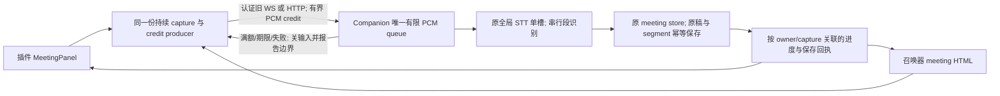

> Implementation checkpoint (2026-10-15): root independently approved R2, the sole R3 speaker, R4 explicit New, and R5 HTTP Begin pin increments for implementation only. The historical frozen contract below is preserved verbatim. The owned d007 implementation now awaits nonauthor source review; real browsers, allowed local model, named Grok/DeepSeek, fresh ARM and exact CI remain pending. This note grants no release or closure approval.

# #494 — 持续会议 PCM 与有界顺序识别合同（设计候选）

GitHub existing Issue: #494。状态：**DESIGN_CANDIDATE / NOT_APPROVED / NO_PRODUCT_IMPLEMENTATION**。源证据基准：公开 main `caca05177efee40ad0ca76ad9cef57251d3f930b`；R2逐项核该23个相关Git对象与已交付 `d00772eda2d430253845595f11f1c491930685aa` 字节相同，不借移动工作区内容。R1原全文/报告/2FAIL与独立REQUEST_CHANGES完整保留；本R2只修当前连接能力观测/发送及真实relay ACK合同，仍待非作者增量正式判定。本文件与配套plan是root明确授权的原494独立设计；不是源码批准、native/browser/model完成、发布或关票。root真正非作者完整合同批准后才可以编码。#476/#480、本轮33path与wire3不在设计/开发范围。

## A. 原需求、实证与明确边界

原494要求插件会议面板与召唤器会议HTML/HTTP持续PCM，推理仍采集，有界识别排队与停止尾段排空，积压/预计延迟可见；保留隐私、麦克风许可与全局单STT槽。两端真实浏览器、至少一本机真实模型和Grok+DeepSeek独立复审是原验收；不是只缩短timer或借492完成。

当前证据：whole插件createLocalSttAdapter在window stop后await final才开下一capture；召唤器actual beginPcm/stopStt/teardown/end/finally startStt同样有暂停。独立actual PCM sample-ID probe两端各96source→64wire、32missing、0duplicates；原条款完整性2tests/0PASS/2FAIL。报告/proof/root收据保存原失败，不写成通过。#492真实转写/参考/尾段保存恢复已交付；其真实单句whisper只是旧基础链路，不是新的持续queue证明。

选择一条架构，不留两个互斥实现给作者猜：**浏览器共享持续capture/连续resampler/有界credit producer → Companion一个内存PCM FIFO → 原SttSessionService全局max1内顺序识别 → 原会议存档/幂等segment保存 → 两端真实状态**。队列不放在两个UI各自无界Promise chain里。ASR worker、queue和capture lifecycle分离；分段sealed不能stop麦克风。

范围只包含上述两个**会议**caller。普通听写/PTT/浏览器SpeechRecognition、文件音频导入、说话人/参考纠错/纪要内容协议保持其已有功能；不宣称本票修复所有dictation连续模式。插件当前local readiness gate不被放宽；召唤器已受trusted voice config选择的local/system路线保留，顺序worker只用已有runner，不能偷偷fallback provider或改配置。原至少一本机local模型验证仍必需；本票不追加全Windows SAPI硬验收作为新前置。

不新增第二扩展、新listener、general overlay方法、native桌面身份、MCP/工具权限、云STT、parallelASR、目录/Executionstore、默认设置或用户配置迁移。不默认持久音频；现有用户显式retain开关及privacy语义不被此票开启。捕获ID/epoch是关联标识，**不是**bearer grant；授权仍实际origin/surface/peer与原privacy门。

风险候选沿用原Issue的T2本机采集/排队：本合同的保护lease/版本/epoch/固定输出是资源与关联协议，不新增身份、方法授权或默认持久音频。但它实改旧STT槽占用及q1transport语义，必须独立协议/owner复审；root确认风险分级，最终diff若扩大许可/方法/音频持久化必须重新冻结并重评，不能借本T2候选跳gate。

## B. 有限数学合同与数值候选（全部待root批准）

有限缓存不能无损承受无限慢识别、无限录音。输入速率为R=16000 samples/s ×2 bytes=32000B/s；未完成PCM量 U(t)=admitted(t)−released-after-terminal-persist(t)。当长期处理速率<输入速率，U必增长至cap。合同承诺的是：健康capture/transport内、被credit合法admit且在停采边界以前的样本均唯一进入队列；不是无限未来声音或失败后丢失的易失缓存永远可识别。

| 数值 | 候选 | 来源 / 不是旧production事实 |
| --- | ---: | --- |
| PCM格式 | 16kHz、mono、s16le | 既有两端/ADR/STT格式不变 |
| 识别段 | 8s=128000samples=256000B；尾段可短 | 既有近实时8s作候选共同行为，large也用8sfinal；不是把旧large45s模式冒相同 |
| 服务器未完成PCM总cap | 60s=960000samples=1920000B | **新候选**；含active/sealed/inflight/persist-pending与已授予但未收满credit，不能各自再给60s |
| resident段descriptor | 最多8个非空段+1个empty builder | 新候选，ceil(60/8)=8；不累积整个会议的queue descriptors |
| producer block | 最多40ms=640samples=1280B | 新候选；允许最后短block，满足旧256KiB raw chunk cap |
| outstanding credit | 最多8个block，10240B=320ms | 新候选；这些字节**先从同一1920000B cap预留**，不是额外buffer |
| recent ACK replay metadata | 最多16条固定ACK+hash | 新候选；更旧credit返回stale/current cursor，不保存3h全ACK日志 |
| 高水提示 | resident+reserved>=48s（80%） | 新候选UI提示，不是新许可或确认步骤 |
| 等待gUM/完成启动 | 30s | 新common候选，只有旧召唤器已有30s许可等待；不称旧两端皆30s |
| stop producer ACK/尾flush | 2s | 新候选；deadline失败明确partial/unknown，不假尾段完整 |
| capture硬上限 | 3h wall与对应172800000 normalized samples两者先到 | 插件既有3h；**召唤器统一该上限是新候选**，不把旧8s window叫3hcap |
| 活跃输入无进展 | 10s | 沿用旧upload idle数值，新的continuous receiving内即使infer中仍检查；draining无新音频不触发 |
| 单段识别 | 不提升旧runner90s/large300s、SAPI15s上限 | worker需重用真实代码；默认client等待95s/large305s仅旧请求宽限，不当新ASR预算 |
| 单段完整处理总预算 | 最多330s | 新外层候选：包含准备/最终识别/清理/保存/通知；不延长runner自身hard limit |
| stop后总drain硬期限 | 60min | **新候选**，取代本q1会议的旧20s提前finalize；legacy/导入/普通dictation不改 |
| 取消后清理反馈期限 | 5s | 新候选；子进程实际未retire时显示清理待完成，不放出STT槽假绿 |

数学一致性：最多8段×330s+2s capture flush+5s清理=2647s<3600s。是healthy内部调度的上界核对，不是实际模型时延/性能承诺；队列满提前停录的音频范围可完整drain，但之后声音不采集。ASR失败、磁盘失败、断线、崩溃或无法终止子进程必须走显式失败，不能用此算式保证一切成功。计入committed_end的无字range仅证明有处理终态与摘要保存，不声称音频已持久化、确定静音或ASR内容准确。

1920000B是应用queue的PCM上限，不是整体V8/browser/OS/model内存上限。仅一个段可以有固定256044B临时WAV/immutable runner副本；capture credits最多10240B且计入cap。原WS/HTTP解析预算、模型内存/临时文件caps仍有自己的旧上限，不能把它们也声称被1920000B涵盖。所有新数字只存在本候选，未写config或源码。

## C. 样本与credit不变量

C1. 第一参考域是实际capture callback获得的raw mono samples：每个合法callback的raw样本只交给连续resampler一次。48k/44.1k→16k是已声明变换，不冒1:1样本数；resampler保留跨callback/段的分数phase和必要一个尾样本，不能每块重置。第二域是normalized16k s16le frames，sample_offset从0单调。所有PCM block/segment范围都是该域半开区间[start,end)。

C2. 健康transport下，从admission开始到生产者seal的N，所有normalized frames严格覆盖[0,N)，范围无洞、无重叠、byte序列与参考resampler输出一致。queue entry被enqueue一次；同credit重复相同block仅返回原ACK，不重入；相同credit不同bytes/range（在最多16条recent ACK窗口内可核）是整个capture protocol failure；更旧duplicate只返回stale/current cursor且绝不重新入队，不能为历史重放保存无界ACK/PCM。ASR输出准确率、empty文本不是样本无损的证据。

C3. 服务器先reserve容量再给credit。credit绑定实际peer/active lease/contract1/capture_epoch/credit_id及范围上限；单block decoded<=1280B且even。服务器受global max1且只一个continuous lease，reservation是PCM budget，不是身份grant。renderer不能自造credit、范围、completion或ACK；原shape/origin/peer校验仍在。

C4. 最多8个credited producer slots和8个对应server reservations；AudioWorklet只能在持有slot时admit帧。没有credit立即关闭admission，stop tracks/报告最后prefix，不再无限postMessage。ScriptProcessor fallback同步消费同样的credit返回值，没有额外Promise音频链。无SAB/COOP/COEP或新CSP权限要求；已有CSP允许的worklet优先，否则复用现有ScriptProcessor能力，能力缺失就明确失败。

C5. block在producer→transport→reserved queue slot转移所有权，同一容量不能双扣/双释放。worker处理immutable sealed range；不能在WAV/runner读取之前复用其ring slots。只有段识别终态并满足保存合同（或显式terminal disposal）才释放；不以send()、chunk HTTP200、partial hypothesis当已识别/已存。

C6. 满额、3h、stop、track revoke、input discontinuity触发producer seal。已合法admitted的末partial block与已发credit必须有界flush；新的音频越过N不admit。未被采集的后续声音明确标边界，不能计成完整会议、偷偷drop后继续麦克风，或无限grow。counter必须区分source/captured/admitted/server_received/processed/saved/discarded；不混成一个“已识别”数。

C7. 浏览器AudioContext suspend/track mute-ended/后台调度异常不是完整音频。以producer时间/offset检测断续，停止本capture并显示input_gap/revoked/suspended。硬期限在下一合法调度机会执行，不能许诺OS挂起时JS实时watchdog或物理麦克风始终无缺口。真实浏览器验证必须覆盖实际可观察gap与失败反馈；不把timer callback次数当完整性。

C8. HTTP可有最多8个credited requests并发而乱序；server只在已预留对应slot内接收，不无界等待/排序。received ACK记录该block，contiguous_received_end只推进连续前缀；sealed segment只能来自连续前缀。WS顺序也不替代验证。end以final block/offset barrier等齐末尾，2s内缺slot/range则明确unknown/partial，不假补零或释放别的epoch credit。

## D. 所有权与唯一全局单槽

D1. 不另开recognizer池。SttSessionService当前全局bound扩成legacy/continuous的判别状态；continuous lease占用原max1，贯穿STARTING→CAPTURING→DRAINING→terminal retirement（含两个ASR段之间）。因此其他peer、另一端、普通dictation不能趁段间隙偷用/抢占；返回原resource_conflict/busy及诚实UI。延长单槽占用是本候选**更严格的资源占用行为变化**，不是宣称旧单窗口策略完全不变。不会有两个ASR child或partial+final并行。

D2. 只有真实authenticated peer与确切meeting_id/capture_id/server capture_epoch可以操作lease。一个server lease对象与epoch在每个await前后检查；旧block/end/abort/timer/child结果均不能影响新lease。前端同样按local transport generation与这些id匹配，只更新原会议UI/存档，不使用当前选中meeting/thread推断owner。未知ID/epoch/mixed字段全拒，不猜idle、不扩大surface。

D3. `meeting.start`旧路径会forceAbort全局STT，`SttSessionService.abort`旧路径允许samepeer mismatch取消当前bound，这是已读真实生产行为。新q1不能依赖仅JS callback fence：continuous lease在服务端固定protected mode。新start不调用全局clear；旧meeting.start在active continuous lease时也不得preempt，必须在创建/修改record前refuse。旧voice.abort即使未带q1字段也不得降级protected lease，必须exact capture/epoch；legacy bound保留原兼容语义。`forceAbort`只留既有服务端shutdown/已拥有的close/timeout路径，并按捕获lease对象identity清理，不能由renderer宣称。

D4. 取消/infer abort期间slot只到**真实runner settle/child cleanup**才可供下一job/新capture；signal.abort不是“已退出”的证明。5s清理反馈可以失败但不能unlock假parallel；卡死显示retiring/busy直至真实关闭或daemon shutdown，已有runner SIGTERM→SIGKILL/timeout复用，不加新命令/runner。

D5. meeting store只加一个有界latest capture summary、单调capture_epoch/OCC与sticky completeness标记，不新建Execution/audio store。new explicit Begin用expected_capture_epoch，当前同capture_id/同actualpeer重试返回同一已commit实例；陈旧epoch在任何元数据/lease mutation前拒，不能旧Start晚到再占新槽。同会议历史每段沿用稳定segment_id；旧无字段历史直接可读，unknown completeness，显式Start才写新summary，不bulk migration。

## E. 旧transport上的最小q1协商与数据合同

下面全是**待实现的明确新合同字段/回执**，不是旧producer已经输出。实施永久fixture必须来自actual handler serializer/manager输出，不手造成功payload。

E1. 能力来自**实际queue-owner backend的当前认证连接观测**。单一纯helper只给真实backend的现有read-only `system.ping` serializer导出contract version1；支持回复为`system.pong.meeting_pcm_contract:1`。这不是proxy/client编译版本的证明。无新client→server动词、HTTP listener、ACL方法、身份grant或预算。

E1a. 插件实际WS sender与召唤器实际`CompanionClient`分别在本次认证完成后，用现有correlated `system.ping`取得实际backend回复。只有来自同一仍current socket/认证生命周期、匹配该次pending request id、type恰为system.pong且meeting_pcm_contract为number 1的回复才建立内部q1 observation；缺失/错类型/未知版本、无关push、旧socket迟到pong、请求失败/timeout都不能建立。client实例相同或OPEN本身不等于认证/能力相同。内部记录只绑定该sender/client实例、实际socket identity及本次认证生命周期，不能由renderer JSON提供；它不是新增bearer/capability字段，不发给UI或写config。只加此q1所需窄connection observation/conditional-send接口，不推广通用generation框架。

E1b. `disconnect`、close/error、auth reset/challenge/failure/重新认证开始、reconnect开始、endpoint/client/socket replacement均立即使旧observation失效；auth.ok本身不恢复q1，要新pong。延迟旧message/close/auth callback不得重建或清掉另一current observation。实际HTTP listener可在后台WS断开时继续活着，故现有authenticated GET `/api/voice-settings`只能投影**当前actual summonerClient**的有效backend observation；没有有效观测就不广告支持/显示contract_unavailable，绝不能附proxy本地helper常量冒支持。若该GET内部await ping，返回前还须核同一current连接；HTTP配置字段仍原范围，不返回内部socket/认证信息。完整HTTP listener重启会轮换现有token，不声称旧HTTP token跨重启可用；危险控制是仍活着的proxy连接旧/更换的backend，不新增token绕过。

E1c. 观测不是日后任意send的许可。每个q1 Begin/start及后续q1发送在**真实sender最终send处**同步核：调用方仍是current client、实际socket仍为观测对象、同一认证生命周期仍有效且OPEN、q1 observation仍有效。任何准备/await（包括readBody、ping、gUM或relay等待）之后都要重核；最后核验→注册该连接的correlated pending→对该确切socket.send必须在同一同步片段内，**无await/排队回调/重连或改取this.ws的缝隙**。不得只在UI先check再调用可任选新连接的generic send。close/send failure使该次失败，不转发到replacement连接、不自动retry未知Start。召唤器HTTP每个q1请求须在`menu-bar-agent.dispatchSummonerWeb`→`tray/companion-client`最终send执行此fence；GET曾为positive、HTTP body自称q1、长寿client对象均不能越过它。插件实际WS sender同样约束，不只会议helper检查flag。

E1d. 任一失败在q1 Start进入旧backend前fail closed：该失败操作新增0 legacy meeting mutation、0 global clear、0 new lease、0 mic admission，不调用旧窗口loop或静默降级。首个meeting.start发送前能力不成立时不得调用gUM；若已经在后续gUM等待/活跃capture期间失联，则应停止/处置已取得或迟到的tracks并禁止新admission，不能谎称gUM从未调用。连接变动后必须fresh backend observation与**新的显式Begin**；不自动重放尚未确认的旧Begin/Start，不自动重新开mic。E2/D5的同operation幂等不是跨连接自动重播入口。实际插件`background/ws-client.ts`的legacy send在认证前可push pending、auth.ok后flush；q1不准进入该pending或经flush重放，最终fence失败就拒绝，只保留原legacy队列语义。现有generation guard可窄复用，不新增general generation框架；仅有generation数字也不能替代actual current auth+pong观测。活跃capture失联仍按F封口/unknown/清理，不能把旧lease的chunk/end/abort自动送到新连接；观察状态/原幂等保存reconcile不代表自动重录。E2/D2–D5的backend protected owner/epoch检查仍不可被此本地fence替代。

E1e（R5唯一HTTP Begin相关性窄增量候选，待root非作者正式批准）. 为封住多HTTP请求间的连接替换，显式Begin先生成existing capture_id，再以GET existing `/api/voice-settings?capture_id=UUID`请求真实backend观测；query只关联本次Begin，不是bearer grant/许可或新WSverb。普通settings GET只投影当前能力，不能创建、替换或复活Begin pin。HTTP server仅一个bounded pending Begin：capture_id、实际current client/socket/auth observation、从首次请求开始的原30s startup deadline与有限accepted阶段；observer await前reserve该pending，await后核仍同一个pending及current观察。有效pending遇不同capture_id诚实conflict，不静默替换；disconnect/authreset/reconnect/client/endpoint/socket变更后旧pending不能重绑，旧capture需失败并由新的显式Begin/新capture_id获取新观测。超30s拒旧pending且不延长期限；同ID重复GET不能续期或跨连接重新授权。

HTTP q1 meeting.start须匹配该pending capture_id、未到期和exact current observation；该HTTP request读取body前snapshot及最后实际sender无await fence仍全部必需。Start成功只有真实matching meeting.started才把实际client owner pin转为accepted capture；同op lostACK在该原30s startup deadline内可同连接幂等重取，speaker/OCC原合同照核，不创建第二lease/epoch；未知Start不自动重试。q1 voice.start实际receiving确认后或startup deadline/失效/terminal时清除pending Begin，不为3h capture额外保留RPC/pending缓存；已accepted capture后续chunk/end/abort仍归原实际client/socket/auth owner pin与server lease，普通settings refresh不能替换它。原30s之后旧Start重播诚实拒绝，不由HTTP绕回legacy；server稳定operation幂等规则仍在其原live lease，不扩大过期HTTP pending窗口。terminal/失效只清匹配原对象，不能误清新Begin；30s失效不伪称已识别/已retired。所有拒分支按该失败q1 operation真实effects增量0legacy mutation/globalclear/newlease/mic，不能用更新后的普通GET positive迁移旧Begin。无新endpoint/config/permission、无限Map或general generation框架。

E2. 现有`meeting.start` q1字段：v:1、id(已实际create/get的meeting)、privacy_ack_v1:true、privacy_ack_v2:true、queue_contract:1、capture_id(UUID correlator)、expected_capture_epoch(nonnegative safe integer)。q1不允许implicit create、audio_retained:true、retain_days、未知/权限字段；这是明确的候选限制：本切片不实现连续原始录音归档。现有显式retain选择若开启，UI必须明确连续q1当前不支持此模式，不得自动关闭用户选项或假称已保留；旧显式retain功能仍在旧路径，不因新queue默认开。服务器先验证实际origin/surface/peer、隐私/模型条件、OCC及global槽，再reserve STARTING并原子写单一summary；写失败只释放自己reserve，不publish成功。实际reply仍`meeting.started`/meeting，新增correlated continuous_capture和cap snapshot；same exact operation lostACK replay不重复增epoch。

E2a（R3唯一窄增量候选，待root非作者正式批准）. q1 `meeting.start`允许可选`speaker:string`，长度<=32；只承接现有插件“本次录制默认说话人”原稿标签。插件在用户显式Begin同步snapshot现有`defaultSpeakerRef.trim().slice(0,32)`；blank省略，Summoner沿既有无speaker输入保持省略。server沿原speaker字符串处理/最多32字符截取边界，不将该手工标签当身份、认证或许可。校验通过后的snapshot固定在该capture lease，后续每个真实server append原稿使用同值；空/未传不制造label。speaker不进入capture_summary、config、权限、status DTO，不改变bulk editable speaker工具、legacy或导入ASR规则。same capture operation lostACK replay还必须比较固定speaker snapshot；不同speaker拒绝collision，不增epoch、不替换lease标签、不覆盖已存原稿。q1 capture/draining继续禁改本次录制默认label；下一次显式capture可用新snapshot。仅此可选标签兼容增量；E1连接观测/owner、E2其余门、E3–E9、全部数值/隐私/单槽不变。

E3. gUM已ready后现有`voice.stt.start` q1字段：v:1、sessionId=capture_id、capture_epoch、queue_contract:1、format:pcm_s16le、sampleRate16000、channels1、既有privacy_ack_v2、既有可信模型/engine规则。不接收新3h maxMs或cap覆盖值；worker8s/queue60s/hard3h是服务端受审常量。收到既有`voice.stt.partial status:receiving`且带exact q1/epoch/初始credit才进入CAPTURING。30s未完成Start释放mic/own lease，迟到gUM立即stop tracks，不能zombie capture。

E4. 现有`voice.stt.chunk`新增q1/epoch/credit_id/sample_offset/frame_count和data。q1必须decoded<=1280B、even、exact frame_count、base64长度先限再decode；legacy仍旧256KiB。成功旧协议本来**没有per-chunk ACK**；q1明确新增server→owner ACK（见E7），仅表示received/enqueued及replacement credit，不表示recognized/persisted。HTTP成功必须relay该actual ACK；不能以空object/200当credit。真实`menu-bar-agent.ts:dispatchSummonerWeb`对q1 chunk须走绑定E1当前连接的correlated `CompanionClient.sendAppRequest`窄分支，`tray/companion-client.ts`按同一socket/request id接收真实E7 ACK，再严格核q1/capture/epoch/credit匹配后返回HTTP/producer；本地send true或合成`{type:"ok"}`不授credit。pending只归该连接，断线拒绝/作unknown，旧迟到回复不能完成新pending。legacy无q1 chunk仍原sendAppMessage/no-ACK语义，不把所有旧chunk改成等待新ACK。

E5. 现有`voice.stt.end` q1是input seal：含final_sample_end与最后credit/block序号，及有限stop_reason(user_stop/capacity/hard_limit/input_gap/permission_revoked/suspended/transport_backpressure/unload)，exact owner/epoch，服务器禁止新credit并对齐最后partial。不等60min才返回一次HTTP：返回actual draining ACK，后续用unicast状态和原authenticated SSE/meeting.get观察。所有reserved尾block在2s内对齐；不能缺块也宣称complete。stop_reason是现authenticated producer观察，不是额外授权；server失败/上限原因优先且sticky，renderer不能用user_stop清掉它。不能声称server独立证明物理麦克风连续。旧end仍其单窗最终结果语义。

E6. 现有`voice.stt.abort` q1确切取消lease；q1在同一E1绑定连接走correlated actual request，backend用E7实际matching status投影立即回取消已受理状态(canceling/retiring；已真实retired才可finished)，不是本地`ok`或signal已发即资源释放。HTTP/tray必须保留request id与capture/epoch匹配及真实拒绝fixed code，不能将wrong/stale owner拒绝吞成成功；后续actual child/terminal仍走状态。legacy无q1 abort维持原sendAppMessage/no-ACK relay，不把旧handler的aborted结果冒为新实际ACK；旧请求面对protected lease同样必须exact identity，不能missing/stale session kill current。同server timer/close只取消原对象，不清新lease。`voice.stt.partial_request`面对q1只返回当前状态，不启动partial ASR；legacy progressive保持。`meeting.end` q1在server drain终态才可结束为ready；其finish outcome由server计算，不接受renderer的complete/saved counter。旧接收字段不得用来绕过q1保护。

E7. 固定server→client `meeting.capture.status`（新增输出事件，不新增overlay执行/审批权限）由实际active lease单向投影：contract1、meeting_id/capture_id/capture_epoch、phase、input_open（服务器信用/admission状态，不冒物理mic状态）、server_received_end、processed_end/committed_end、saved_text_segments、resident_seconds、sealed_segments、inflight_segment、high_water、ETA nullable、stop_reason、completion(outcome/prefix_complete)、fixed error code。credit ACK同时含credit_id/accepted_through/最多8个replacement grant；字段type/range严格，**不含raw PCM、capability、peer credential/config/model路径**。phase固定starting/capturing/draining/canceling/retiring/finished/failed，outcome固定complete/limited/cancelled/failed/interrupted。新增error仅contract_unavailable/stale_capture/queue_protocol_error/startup_timeout/capture_flush_timeout/network_unknown/save_failed/drain_timeout/cleanup_pending；原ASR fixed codes原样映射，不回显raw异常/路径。localcapture_active由实际track/context状态决定，UI不能仅因server input_open就宣称mic在采集。全局广播不得泄露给未授权peer；Summoner现SSE event allow仅加此受限输出家族。client也校验matching ids，不从status发新工具/授权。

E8. segmentId=`capture_id-epoch-sN`，样本range不可改，长度必须落现sanitizeSessionId上限内。worker是FIFO，一次normal recognition；不自动duplicate ASR retry未知结果。actual text result先可作为未保存原文投影，再走原appendTranscript稳定segment_id；保存ACK、range与owner匹配后才saved/release。lost保存ACK用原幂等reconciliation，不重跑ASR；same ID different text/range拒绝。empty_result只能标“该段未识别到文字”终态，并保存该range的有界进度摘要（不编造TranscriptLine、不落PCM）后才推进committed_end，不能声称确定静音/准确识别；不伪造文字、不因纯empty自动把后续samples丢掉。infer_failed/timeout不是empty，进入显式失败。

E9. 持久摘要仅固定小字段：capture_epoch、last_capture_id、phase/outcome、last durable server_received_end和committed_end（lower-bound checkpoint）、known_unprocessed_end nullable、fixed reason集合、sticky incomplete。每个sealed/persisted段及stop/terminal更新，不写每块/原PCM；最多一个latest summary+有限reason枚举。旧记录无摘要=unknown。后续成功capture不清同会议曾提前停录/失败的sticky incomplete，只有新会议自然重新开始。分钟/导出使用既有source provenance并显示known incomplete/unknown，不把有保存文字当全场音频完整。

## F. 状态/停止/错误：每种尾段都有归宿

| 状态/事件 | producer与队列 | 存档/用户可见 | 下一start |
| --- | --- | --- | --- |
| STARTING | reserve原槽；30s内gUM与creditready，未ready不admit | 准备中，非录制完成 | 重复同op幂等；别的op busy |
| CAPTURING | 同一graph跨所有8s段；FIFOworker处理时继续capture | 可同时“采集中/识别中/积压”；状态非互斥 | 同槽其他caller拒 |
| user Stop | 立刻关admission/stop tracks；2s内seal partial，queue保留已收prefix | 正在排空，不能先meeting.end/生成 | 必须终态或明确Cancel |
| capacity/hard cap | 不再发credit；自动stop，明确N；正常drain此前prefix | “提前停录/上限，到N秒排空；之后声音未采集” | terminal limited，不称整场complete |
| 完整drain | 每admitted range识别终态/存档对齐，释放/清理 | prefix_complete；normal Stop可complete，提前上限是limited | retire确认后允许 |
| Cancel | 原epoch原对象取消；禁止新append；pending PCM清零，有界dispose | 已存prefix保留；未处理范围discarded/partial | actual child retired才允许 |
| 网络失联/unknown ACK | producer无credit停采；服务器10s active-idle封口；不自动ASR重放 | 未收到范围unknown，已存prefix可见，不能绿finalize | 重连只refresh/幂等保存reconcile；显式新start |
| ASR/磁盘失败 | 封输入，保存已有original text；不skip失败段继续假全成功 | 固定error与未处理数量；原保存重试可用，队列不再无限grow | 明确结束失败/Cancel；严格retire |
| revoke/mute/gap | stop tracks/封口，dispose/可完成已知prefix | 停采原因与gap范围known/unknown，非无缝 | 用户重新Start，不自动重申请 |
| unload/renderer crash | best-effort exact cancel，不依赖beacon才安全；server idle/peer-close兜底 | 内存未ACK数据可能不可恢复；重开不自动开mic | 摘要显示partial/unknown |
| daemon crash/restart | 全内存PCM消失；原child结束/启动reconcile现recording | 最后durable checkpoint以后范围未知；已保存原稿仍在；不得伪补录音 | 清旧lease、newepoch、显式Start |
| 60min drain deadline | abort exact job、dispose剩余PCM，actualretire guard | timeout/partial及剩余range；绝不“成功结束” | childretire后允许 |

normal userStop在健康预算内必须排空末partial，窗口seq不能重复追加；Cancelled callback与save竞态按同步owner-check→原store commit的先后决定：commit先赢则该段prefix已存；cancel先赢则late callback无写入。谁赢都不能回滚已存文字或向另一个meeting追加。旧20s整体stop watchdog仅q1路径改为上述drain，未处理段不以超时强制完成；legacy20s/dictation12s不借此票全改。

## G. 两端实际UI与ETA

G0（R4唯一有限UX合同候选，待root非作者正式批准）. 两端用户显式点击现有“新会议/新建会议会话”动作时，可调用原existing meeting.create/API创建draft并保存该真实ID；这是独立显式动作，不在Begin内部自动create。Summoner原New只清视图的行为在此窄改为原create回执成功后才选中该draft。Begin没有已create/get的ID时清楚提示先新建或选择历史，零create/meeting.start/mic；有ID仍先actual backend当前能力观测→get/OCC→同连接q1Start。Begin失败不回滚此前独立成功显式draft；T12a按该失败q1操作实际effects增量断言零legacy meeting mutation/globalclear/lease/mic，并单列此前显式create成功，不换计数隐藏自动Begin mutation。显式create失败不能保存伪ID或启动mic；切换/迟到create回执沿原owner/view guard，不能retarget活跃capture。无新endpoint/权限/默认配置，E1fence、E2existing-only与其余合同数值不变。

两端同状态DTO，真实caller各自render，不假共用MeetingPanel。保留原参考笔记、导入/纪要/说话人/模板/原稿权限；新queue不把参考文字当系统指令。Stop与Cancel未处理音频是不同可达按钮，窄/短窗可读queue秒数、“已处理到X秒/原稿Y段已保存”；不是L2审批/新隐私ack。

示例：`采集中 · 识别第3段 · 积压2段（16秒） · 若现在停止，预计约11秒排空`。80%显式提示接近上限；cap后“已停止采集，正在排空此前范围”，不再显示“正在听”。新queue健康infer时删旧“麦克风暂时暂停”文案，实际input stopped时仍诚实显示，不以文案替代码。

ETA是估计：至少2个已完成job后，以同一pinned engine/model的end-to-end time/audio-duration EWMA（候选alpha0.25）乘待处理秒数，减正在执行job已耗时间并floor0；包含保存时间，避免重复相加。首次/冷模型/无稳定history为null显示“预计延迟未知”；用于“若现在停止”而不是无限未来会议的完成承诺。超harddeadline/异常变慢显示不确定，不增加预算或静默换模型。counter、ETA与UIrevision均非新授权依据。

normal switch/newMeeting沿用原停止收尾guard；drain可长，必须可Cancel。意外选中/迟到status不得重选旧meeting或控制别人的capture，先show matching owner state再执行任何用户动作。plain status/counters来自producer；浏览器测试要亲核真的DOM/按钮区域/键盘，不能只snapshot JSON或header。

## H. 共享source与打包合同

服务端queue/segmentation/worker只在Companion TS里一份SoT，不把两个UI的Promise链复制成“shared”。共享浏览器capture/resampler/credit-adapter是一份browser-only TS源（候选extension voice目录），无Chrome API/Node依赖；插件normal import，召唤器由现有esbuild/TypeScript工具在build阶段生成固定IIFE string TS asset，纳入原nonce inline脚本，不加runtime transpiler/eval、新endpoint/CSP/permission或外部依赖。generated asset可提交但CI必须从同canonical输入重生byteexact检查source SHA/buildtool版本，不能手修两份。原Companion rootDir src不被跨包TS import破坏。

AudioWorklet与ScriptProcessor是同capture合同的两个adapter；若CSP不支持worklet只能用已允许fallback，不为本票开启DevTools/blob/remote脚本权限。连续resampler必须both path同输出。binding/queue/CPU模型保持在原Companion；没有在renderer加载ASR模型。

## I. 冻结验收 AC 与原494逐条映射

- AC1 actualproducer PCM reference at16k与44.1/48k跨callback/segment，slow final仍capture；accepted healthy[0,N)无洞无dup，旧两端96→64 permanent counterexample在实际新caller变96→96。不以新purehelper独绿代表caller完成。
- AC2 reserve/credit/global memory三边界before/exact/overcap，各种block/partialtail/duplicated credit/unknown/bad range；bounded allocation、capacity stop明确N、已收prefix真drain、无静默drop/无限grow。
- AC3 server实际peer/epoch/globalmax1及legacy兼容；两个caller并发、一端dictation、samepeer旧abort、oldmeeting.start、stale timers/childcompletion不能抢/清新lease；actual child active max1（fake runner counters+实际允许真实runner验证分开）。
- AC4 userstop/start/cancel/unload/revoke/network/daemon restart/crash与hardcaps；input封口、partialflush、drain/save/idempotent lostACK、cancel-vs-commit、dispose/retire、未知range诚实，失败全保存。
- AC5 actual serializedpayload/validator/router/HTTP/SSE/meetingstore；新cap absent oldserver不能q1unsafeStart；actual newproxy/oldbackend、pong后disconnect/auth reset/reconnect/endpoint或client replacement在send前发生、迟到/invalid pong均需0旧mutation/globalclear/lease/mic，current同连接positive须真抵backend且q1 chunk/abort返回actual correlated ACK；错误/mixed敏感payload全拒，oldmethodACL不扩；新DTO只fixed projection，无rawPCM/secrets/log全文。
- AC6 两端真实DOM queue/ETA/capture/infer并发状态及Stop/Cancel可达；narrow/short/keyboard、owner switch/stale回复不会retarget；现492材料/生成/partial-write回归保留。 R3标签兼容控制：实际插件Begin snapshot→实际lease→server append归档同值；blank/omitted无label、32字符边界；同op不同speaker collision零epoch/lease/原稿变化；capture/drain禁改、下一capture可改；Summoner仍无label，status/summary/config/权限无speaker。
- AC7 两端实际浏览器+连续合成PCM设备/流/可延迟实际worker，至少一本机真实已允许模型，证明新pipeline样本/排空与资源，未native或真实ASR不得冒通过；不额外要求所有网站/所有native OS/企业SSO。
- AC8 owningfocused红→绿、必要sharedhost/lockedARM/build/真正非作者完整合同/源码 review、原named Grok+DeepSeek真实最终身份、exact PR head/main CI与root scope验收完成后才closed494。Grok/DeepSeek原要求保留；工作日禁止Pi；当前GLM驱动Claude不是DeepSeek，不能冒名替代。当前阶段不跑任何judge。root合同批准是编码前D0，不等于实现/模型/CI通过。

原条款1→AC1/2/3；原状态与恢复→AC4/6；原缓存/崩溃/许可/硬时限/隐私→B/C/D/F/AC2–5；原真实两浏览器/本机模型/独立复审→AC7/8。No current ACCEPT/APPROVE结论。本spec里的固定策略、状态/字段、数字与文件位置都是待root非作者决定的设计候选；批准后实现不能默默漂移，不可直接把候选常量当旧productionbounds。
